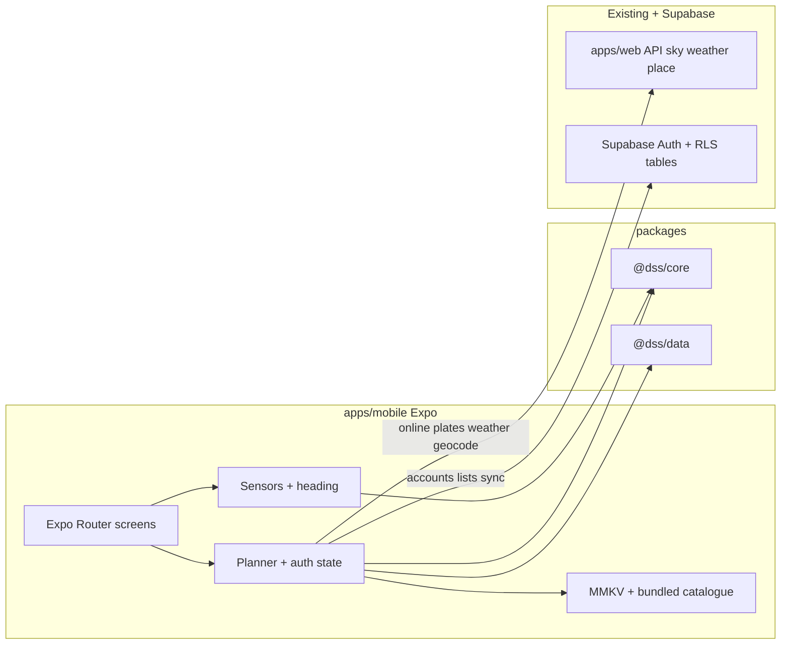

# DeepSkyMate Expo Mobile App

## Goal

Ship a native iOS/Android app with Expo that is **redesigned for mobile**, not a web port. Reuse astronomy/gear math from shared packages. Add accounts, saved lists, offline catalogue/planning, and compass/sky helpers in phases.

Web (`apps/web`) stays as-is for now; mobile is the new primary product surface.

## Architecture

**Defaults locked in:**
- Expo SDK + **Expo Router** (file-based tabs/stacks) at [`apps/mobile`](apps/mobile)
- Shared imports: [`packages/core`](packages/core), [`packages/data`](packages/data) via `workspace:*`
- Online APIs: call deployed Next routes (`/api/sky`, `/api/weather`, `/api/place`, `/api/geocode`) via `EXPO_PUBLIC_API_URL` (no new API server in v1)
- Auth/data: **Supabase** as sketched in [`supabase/README.md`](supabase/README.md)
- Local persistence: **MMKV** for session/prefs; catalogue ships in the app bundle from `@dss/data`
- UI kit: React Native + StyleSheet tokens (dark/night only); no light theme

## Mobile IA (redesign)

Four tabs:

1. **Tonight** — setup chips (location/date/scope/camera), shortlist, expand target with facts + altitude chart + framing
2. **Lists** — favorites and named observing lists (local-first, sync when signed in)
3. **Sky** — compass helper: heading to selected target, altitude/azimuth readout, night mode
4. **You** — account, saved rigs, theme (dark/night), offline status

Mobile layout rules: single-column by default; framing and altitude stack vertically on phone; side-by-side only on large tablets. Brand-forward splash/first screen with DeepSkyMate lockup. Night-vision theme remains first-class.

## Phase 1 — Scaffold + redesigned planner shell

- Create `apps/mobile` with Expo Router, TypeScript, pnpm workspace wiring in [`pnpm-workspace.yaml`](pnpm-workspace.yaml) / [`turbo.json`](turbo.json)
- Metro config: resolve `@dss/core` and `@dss/data` (watch folders + package exports)
- Port planner state from [`apps/web/lib/use-planner.ts`](apps/web/lib/use-planner.ts) into `apps/mobile/src/state/use-planner.ts` (Async/MMKV instead of `localStorage`; same setup gating: location + date + scope + camera before targets)
- Screens: Tonight list, target detail, location/date/gear sheets
- Wire weather/place/geocode/sky to `EXPO_PUBLIC_API_URL`
- Framing: image from `/api/sky` + RN gesture pan/rotate overlays (reimplement [`framing-preview.tsx`](apps/web/components/framing-preview.tsx) with `react-native-gesture-handler` / Reanimated)
- Altitude: SVG chart via `react-native-svg` using the same track data from `@dss/core`

## Phase 2 — Offline catalogue + planning

- Bundle core + extended catalogue JSON already exposed by `@dss/data` (`./catalogue`, `./catalogue-extended`)
- Ranking, night track, optics, search run fully offline once site + gear exist
- Cache last weather payload and last framing plate bytes (size-capped) for graceful offline viewing
- Explicit offline banner when network is missing; sky plate / live geocode require network

## Phase 3 — Accounts + saved targets/lists

Implement Supabase schema (SQL migrations under `supabase/`):

- `profiles` (user id)
- `gear_profiles` + child telescope/camera/filter rows (per existing README)
- `target_lists` (id, user_id, name, created_at)
- `target_list_items` (list_id, object_id, notes, sort_order)
- `saved_targets` (user_id, object_id, pinned notes) for quick favorites

RLS: users only read/write own rows. Mobile uses anon key + Supabase Auth (email magic link first).

Sync model: local MMKV/lists are source of truth when signed out; on sign-in, merge/upload then pull. Favorites work offline and queue when online.

## Phase 4 — Compass / sky helpers

- `expo-location` + `expo-sensors` (magnetometer / heading)
- From selected object + site + now: compute azimuth/altitude via `@dss/core` (extend with a small `horizontalCoords` helper if not already exported)
- Sky tab UI: compass ring, “turn left/right”, altitude cue, optional flashlight-safe night theme
- Permission copy and fallbacks when sensors unavailable (simulator)

## Repo / tooling changes

- Add `apps/mobile` scripts: `dev`, `typecheck`, `lint`; root turbo includes them
- Env: `EXPO_PUBLIC_API_URL`, `EXPO_PUBLIC_SUPABASE_URL`, `EXPO_PUBLIC_SUPABASE_ANON_KEY`
- Keep web API CORS open for the Expo origin / any (sky plate is public astronomy data)
- Document: `pnpm --filter @dss/mobile start`, iOS Simulator / Android emulator, EAS build later

## Out of scope for this plan

- Redesigning the Next.js web UI in parallel
- Push notifications / clear-sky alerts
- Full AR camera overlay (compass helper only in v1)
- App Store / Play Store submission (EAS config can be prepared; store listing later)

## Success criteria

- Installable Expo app on iOS and Android that plans a night offline with bundled catalogue
- Sign-in, create a list, save targets, see them after relaunch
- Sky tab points toward a selected target with live heading
- Framing and weather still work online against existing APIs
