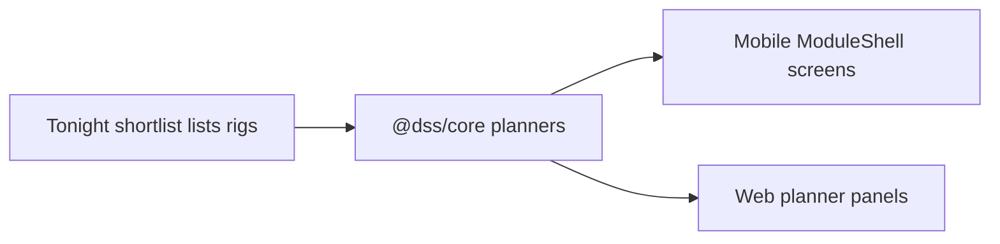

# Planner tab — development plan per module

## Current state

- Hub lists six modules; Multi-target, Single-target, and Multi-rigs are shipped (no Soon badge). Mosaic, Collage, Asterisms remain stubs.
- Mobile screens under [apps/mobile/app/planner/](apps/mobile/app/planner/); web panels via [apps/web/components/planner-hub.tsx](apps/web/components/planner-hub.tsx).
- **Export CSV** ships on Tonight target details (under the altitude graph), not as a Planner module.
- Reusable today: `buildNightTrack`, ranking/shortlist, `suggestExposure`, FOV/optics, saved lists/favorites, named `GearRig`s, altitude charts, `buildPlanCsv`, `planMultiRigs`.

## Shared foundation (do first)

- Add pure planners in `@dss/core` (one module file or folder per feature) with unit tests — keep UI thin.
- Give web the same routes/panels as mobile (hub row → detail page).
- Drop the **Soon** badge when a module ships MVP; keep parity mobile ↔ web.
- Persist plans locally first (AsyncStorage / localStorage); Supabase sync later if accounts are on.

Recommended ship order: **Multi-target → Single-target → Multi-rigs → Mosaic → Collage → Asterisms**.

---

## Export CSV (Tonight, not Planner)

**Placement:** Target detail — mobile under Frame ([apps/mobile/app/target/[id].tsx](apps/mobile/app/target/[id].tsx)); web under the altitude chart ([apps/web/components/target-csv-export.tsx](apps/web/components/target-csv-export.tsx)).

**Core:** `buildPlanCsv` / `planCsvRowFromTarget` — one row for the open target (frame fill, usable hours, band from shortlist when available).

**MVP done when:** User can share/download a valid CSV for the open target from Tonight details on both platforms.

---

## 1. Multi-target planner

**Goal:** Plan several targets in **one night** with overlapping windows and hour budgets.

**Core:** Given site/date + object ids + active optics: per-target imageable intervals (`buildNightTrack`), overlap matrix, greedy shoot-order (rise / peak / set), allocate total dark hours across targets (user weights or equal split).

**UI:** Add from shortlist/search/favorites (cap ~6–8); shared altitude overlay; per-target hour budget editors; ordered “shoot list” with start/end clocks; save named session locally.

**Reuse:** Ranking scores, altitude chart patterns, target pickers from Tonight.

**MVP done when:** Pick 2+ targets, see shared windows + ordered hour plan for the active site/date/rig.

---

## 2. Single-target planner

**Goal:** Given **one** object and total integration hours needed, return the dates and imageable windows that reach that goal.

**Core:** From Tonight’s start date, search forward night-by-night (`buildNightTrack`) until cumulative planned hours meet the goal (or max search); each contributing night includes usable/planned intervals, moon, and running total.

**UI:** Target picker; total hours needed (default from `suggestExposure`); result list of dates with imageable clock ranges + hours toward the goal.

**Reuse:** `suggestExposure`, `moonPlan` / band advice, `buildNightTrack`, `takeHoursFromIntervals`.

**MVP done when:** User picks target + hours and gets the date/window schedule that covers the goal.

---

## 3. Multi-rigs

**Goal:** Assign targets/filters across several named rigs on the same night.

**Core:** Session model `{ night, assignments: [{ rigId, objectId, filterIds, plannedHours }] }`; per-assignment FOV fill + imageable hours under that rig’s optics; conflict flag when two assignments need the same object at overlapping peaks without enough hours.

**UI:** Rig columns from existing `planner.rigs`; drag/pick target per rig; filter chips from each rig; night summary timeline.

**Reuse:** Equipment library + `GearRig`, optics/FOV, tracks.

**MVP done when:** At least two rigs each have a target + planned hours for one night with per-rig framing stats.

**Shipped:** `@dss/core` `planMultiRigs` + conflict detection; mobile `/planner/multi-rigs` and web `MultiRigsPanel` (rig columns, filters, FOV fill, night timeline). Hub Soon badge removed.

---

## 4. Mosaic

**Goal:** Grid framing for objects larger than the FOV.

**Core:** `planMosaic({ centerRaDec, fov, rows, cols, overlapPercent, rotationDeg })` → panel centers (RA/Dec), panel FOV polygons, coverage vs object major axis; warn if object still undersampled.

**UI:** Target or custom center; rows×cols + overlap + rotation; panel list with sky-plate thumbs; copy panel coordinates.

**Reuse:** `fieldOfView`, sky plate API, frame-fill hints (`frameFitHint` already mentions mosaics).

**MVP done when:** User gets a rows×cols panel list with coordinates for the active FOV.

---

## 5. Collage

**Goal:** One wide creative frame that includes several chosen targets (not a regular mosaic grid).

**Core:** Given target positions + optional wide FOV (or “fit all”): compute bounding center/span, suggested rotation, which targets fit vs fall outside; optional padding %.

**UI:** Multi-select targets; live framing preview; readout of required FOV vs current rig; swap to a wider scope/rig suggestion if current FOV cannot fit.

**Reuse:** Mosaic geometry helpers, optics list, sky preview.

**MVP done when:** Multi-select shows a single framing solution and fit/out list for the active (or suggested) FOV.

---

## 6. Asterisms

**Goal:** Browse and frame known star patterns / informal groupings.

**Core + data:** Small asterism catalogue in `@dss/data` (id, name, constituent stars/RA–Dec, span); search; framing advice vs FOV (fits / tight / needs wider).

**UI:** Searchable list; detail with overlay/sky plate; “use as collage seed” link into Collage.

**Reuse:** Sky explorer patterns, FOV math, catalogue search UX.

**MVP done when:** Fixed starter set (e.g. 15–30 well-known asterisms) is searchable and frame-checkable against the active rig.

---

## Cross-cutting delivery notes

- **Tests:** Vitest in `@dss/core` for each planner function before UI.
- **Performance:** Cap multi-target count; mosaic panels ≤ ~5×5 for MVP; lazy sky plates.
- **Empty states:** Require setupReady (site + date + scope + camera) like Tonight.
- **Subscription copy:** Profile already mentions mosaic/multi-rig as paid later — keep MVP free/local; gate cloud sync later if needed.
