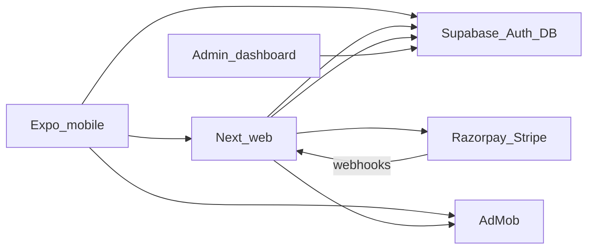

# Pre-store platform infrastructure

## Locked decisions

- **Auth:** email **OTP** (6-digit) via Supabase — not magic-link as primary.
- **Billing:** **Razorpay** (India) + **Stripe** (rest of world) on **web checkout**; entitlements live in Supabase; mobile reads plan and opens the web billing portal to subscribe/manage (avoids shipping native IAP in this phase; App Store still requires IAP for in-app digital purchases — mobile must not present an in-app “pay here” checkout).
- **Ads:** live AdMob slots + remote placement config from admin (store questionnaires will declare ads).
- **Admin:** Next.js `/admin` with role-gated access — stats, users, subscriptions, ads, content, revenue, plus ops tools below.
- **Store plan:** [.cursor/plans/store_publish_plan_a5def0e6.plan.md](.cursor/plans/store_publish_plan_a5def0e6.plan.md) must be revised after this work (no longer free/no-ads launch).

---

## Phase 0 — Hosted foundation

1. Create Supabase project; apply existing [supabase/migrations/20261121_mobile_accounts_lists.sql](supabase/migrations/20261121_mobile_accounts_lists.sql).
2. New migration(s) for platform tables (see Phase 1 schema).
3. Deploy [apps/web](apps/web) to production HTTPS (Vercel); set `EXPO_PUBLIC_API_URL` for mobile.
4. Env: mobile `EXPO_PUBLIC_SUPABASE_*`; web `NEXT_PUBLIC_SUPABASE_*` + **server-only** `SUPABASE_SERVICE_ROLE_KEY`, Razorpay/Stripe secrets, Sentry DSN, AdMob IDs.
5. Add [apps/web/.env.example](apps/web/.env.example); keep service role off the client.

---

## Phase 1 — Schema + entitlements

Extend `profiles` and add:

| Table / change | Purpose |
|---|---|
| `profiles.role` (`user` \| `admin`) | Admin gate |
| `profiles.display_name`, phone, photo URL sync | Profile cloud sync |
| `profiles.deleted_at` / deletion workflow | Account deletion |
| `subscriptions` | `user_id`, `plan`, `status`, `provider` (`razorpay`/`stripe`), external IDs, period end |
| `payments` / `webhook_events` | Audit + idempotent webhook processing |
| `ad_placements` | Slot key, network unit id, enabled, platforms, fill priority |
| `app_content` (or similar) | Admin-editable notices / featured copy |
| `admin_audit_log` | Who changed what |

RLS: users own their profile/gear/lists/subscription **read**; writes to subscriptions/payments/ads/content only via service role (webhooks + admin API).

Wire **gear sync** (schema already in migration; no client today) and **profile sync** from mobile/web storage into `gear_*` + `profiles`.

---

## Phase 2 — Email OTP auth (mobile + web)

**Mobile** — replace magic-link-only UX in [apps/mobile/src/state/auth-context.tsx](apps/mobile/src/state/auth-context.tsx) and [apps/mobile/app/(tabs)/profile.tsx](apps/mobile/app/(tabs)/profile.tsx):

- `signInWithOtp({ email, options: { shouldCreateUser: true } })`
- `verifyOtp({ email, token, type: 'email' })`
- UI: email → send code → 6-digit entry → session
- Keep optional password set for signed-in users
- **Account deletion:** authenticated call to a web API that deletes Auth user + cascading data (and clears local storage)

**Web** — add `@supabase/supabase-js`, auth provider, and real sign-in in [apps/web/components/profile-hub.tsx](apps/web/components/profile-hub.tsx) (same OTP flow).

Configure Supabase Auth email templates for OTP codes (not magic links).

---

## Phase 3 — Payments (Razorpay + Stripe)

1. **Plan catalog** (code + DB): Free / Paid tier(s) matching subscription copy (cloud sync limits, multi-rig, mosaic exports).
2. **Web billing pages:** `/billing` (choose plan) + `/billing/portal` (manage); country/currency routing:
   - India → Razorpay Checkout / subscriptions
   - Else → Stripe Checkout / Customer Portal
3. **Webhooks:** `POST /api/billing/razorpay` and `POST /api/billing/stripe` → verify signature → upsert `subscriptions` + `payments` (idempotent via `webhook_events`).
4. **Entitlement helper** in shared client code: gate paid features from `subscriptions.status`.
5. **Mobile** [subscription.tsx](apps/mobile/app/profile/subscription.tsx): show current plan from Supabase; CTA opens production web `/billing` (no in-app Razorpay/Stripe SDK).

---

## Phase 4 — Ads

1. Integrate AdMob (Expo config plugin) for banner/interstitial **slot components**.
2. Fetch `ad_placements` (or a public config endpoint) so admin can enable/disable slots without a store resubmit.
3. Place slots in non-critical chrome (e.g. profile/lists footers, between planner sections) — never over sky framing controls.
4. Respect paid entitlement: **hide ads for active paid subscribers**.
5. Update legal copy in [apps/web/components/legal-pages.tsx](apps/web/components/legal-pages.tsx) + mobile about to disclose ads/analytics.

---

## Phase 5 — Admin dashboard (`/admin`)

Next.js App Router under `apps/web/app/admin/*`, server-gated by `profiles.role === 'admin'` (service role for queries).

**Must-have**

- **Dashboard:** DAU/WAU (from auth/session heuristics or Sentry/analytics later), signups, active subs, revenue (period), API error rate stub from logs if available
- **Users:** search, role, subscription status, force sign-out / soft-delete, open detail
- **Subscriptions:** list/filter by provider/status; manual grant/revoke (support)
- **Ads:** CRUD placements, enable flags, unit IDs
- **Content:** app notices / featured blurb
- **Revenue:** Razorpay + Stripe totals from `payments` (reconcile view)
- **Audit log** of admin actions

**Good-to-have (include in same admin shell)**

- API health / rate-limit hit counters
- Export users CSV
- Feature flags table (`feature_flags`) toggled from admin
- Impersonation **disabled** by default (document only; skip code unless needed)

---

## Phase 6 — Cross-cutting launch requirements

| Item | Approach |
|---|---|
| Public `/privacy` + `/terms` | New routes rendering [legal-pages.tsx](apps/web/components/legal-pages.tsx) |
| Production API | Vercel deploy; mobile env pointed at it |
| API rate limits | Edge/middleware or per-route token bucket on `/api/sky`, weather, geocode, place (IP + optional user) |
| Crash reporting | Sentry on mobile + web |
| Account deletion | In-app + web settings → `POST /api/account/delete` (service role) |
| Gear/profile sync | Mobile/web upsert after local save when signed in; pull on login |
| Lists sync | Keep existing [lists-context](apps/mobile/src/state/lists-context.tsx); auto-sync on login in addition to manual |

---

## Phase 7 — Align store publish plan

Update store plan defaults:

- Declare **ads** and **optional account** in privacy questionnaires
- Subscription is **real** via web billing (disclose external purchase)
- Crash/analytics vendors in privacy nutrition labels
- Keep EAS/store submission sequence after this platform work is live and smoke-tested

---

## Implementation order (execution)

1. Supabase host + migrations + production web API  
2. OTP auth mobile/web + account deletion  
3. Profile + gear sync  
4. Billing webhooks + entitlement gating + mobile portal CTA  
5. Ad slots + remote config + paid suppresses ads  
6. Admin dashboard modules  
7. Legal routes, rate limits, Sentry  
8. Revise store publish plan + end-to-end smoke  

## Out of scope for this plan

- Native Apple/Google IAP / RevenueCat (follow-up if review requires in-app purchase)
- Push / clear-sky alerts
- Panchang engine
- EAS store submission itself (existing store plan, after revision)
