# DeepSkyMate store publish plan

## Defaults (locked for this plan)

- **Launch as free** — keep Subscription as “Free / paid later” (already in [apps/mobile/app/profile/subscription.tsx](apps/mobile/app/profile/subscription.tsx)); **no** Apple/Google in-app purchases in v1.
- **Build path:** Expo **EAS Build + EAS Submit** (no day-to-day Xcode/Android Studio).
- **Store order:** Play Store first (faster), then App Store.
- **Company:** Auspico Labs (`hello@auspicolabs.com`); IDs already set as `com.darkskyscapes.deepskymate` in [apps/mobile/app.json](apps/mobile/app.json).

```mermaid
flowchart TD
  prep[Prep_v1_and_legal]
  api[Live_production_API]
  accounts[Apple_Google_Expo_accounts]
  eas[EAS_config_and_builds]
  test[Internal_TestFlight_Play]
  play[Play_Store_submit]
  apple[App_Store_submit]
  live[Live_and_iterate]
  prep --> api --> accounts --> eas --> test --> play --> apple --> live
```

---

## Phase 1 — Product freeze and legal (owner + light code)

1. Freeze **v1.0.0** feature set; stop new planner modules until after first release.
2. Real-device smoke test: Tonight → Planner modules → Sky → Profile (online + airplane mode).
3. Expose **public HTTPS** Privacy + Terms on the web app (stores require a URL, not only in-app text).
   - Add routes such as `/privacy` and `/terms` that render existing content from [apps/web/components/legal-pages.tsx](apps/web/components/legal-pages.tsx).
4. Confirm subscription copy stays non-purchasable (already fine for review).

---

## Phase 2 — Production backend

1. Deploy [apps/web](apps/web) to a stable HTTPS origin (Vercel or custom domain).
2. Point mobile production env at that origin:
   - `EXPO_PUBLIC_API_URL` (see [apps/mobile/.env.example](apps/mobile/.env.example))
   - `EXPO_PUBLIC_SUPABASE_URL` / `EXPO_PUBLIC_SUPABASE_ANON_KEY` if accounts/lists sync are in v1
3. Smoke-test weather, place, and sky plate APIs from a phone against the **production** URL (not localhost).

---

## Phase 3 — Store and Expo accounts (owner)

1. **Expo** account at expo.dev (for EAS).
2. **Google Play Console** (~$25 one-time) + org verification docs ready.
3. **Apple Developer Program** as Organization (~$99/year) for Auspico Labs; wait for enrollment.

---

## Phase 4 — EAS project setup (technical helper / Agent)

In [apps/mobile](apps/mobile):

1. Add EAS (`eas.json` with `preview` + `production` profiles); link Expo project.
2. Bump [apps/mobile/app.json](apps/mobile/app.json) / package version to **1.0.0**; set `ios.buildNumber` / Android `versionCode` for first store builds.
3. Configure EAS secrets/env for production API + Supabase.
4. Produce first builds:
   - Android **internal** `.aab` (and optional APK for sideload smoke)
   - iOS build for **TestFlight**
5. Document exact commands in [apps/mobile/README.md](apps/mobile/README.md) (build, submit, env checklist).

---

## Phase 5 — Store assets and listings (owner)

Prepare once, reuse:

- 1024 icon, Android feature graphic, 4–8 screenshots (Tonight, framing, planner, sky, profile)
- Short + long description, support email, marketing/support URLs
- Privacy policy URL from Phase 1
- Data safety / App Privacy answers: location, optional account email, no ads, no IAP

---

## Phase 6 — Closed testing

1. **Play:** Internal testing track → install → full smoke.
2. **iOS:** App Store Connect app record → EAS Submit → TestFlight → install → full smoke.
3. Fix crashes / broken API before public review.

---

## Phase 7 — Public submit

1. **Play Console:** production track with production `.aab` → submit.
2. **App Store Connect:** select build, fill questionnaires, add reviewer notes (location/compass purpose; login optional; no paid features).
3. Address first-round rejections (privacy URL, permission copy, network failures) and resubmit.

---

## Phase 8 — After launch

1. Monitor crashes and API uptime.
2. Each update: bump version → EAS build → store submit.
3. Defer real paid plans until IAP/Play Billing is a dedicated follow-up project.

---

## What this plan will change in the repo (when executed)

- New: `apps/mobile/eas.json`, EAS-related app config fields, README publish section
- New: web `/privacy` and `/terms` (or equivalent) public pages
- Version bump to 1.0.0 in mobile package/`app.json`
- No IAP SDK work in this plan
